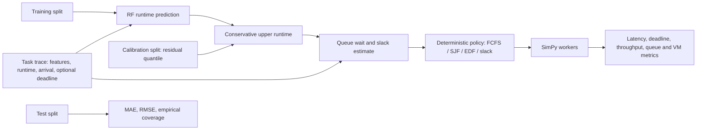

# Random Forest–Augmented Queueing for Cloud Resource Scheduling

[](https://github.com/pranay-prog/cloud-scheduler-using-ml/actions/workflows/ci.yml)

A research simulation framework for cloud resource scheduling. It combines a Random Forest service-time predictor with queueing-based autoscaling to study how arrival and service-time variability affect latency, SLA violations, and compute usage.

The current benchmark uses synthetic workloads and a discrete-event simulator. Treat its results as simulation evidence, not production-cloud measurements.

## How it works

- **Track two queues:** `B(t)` absorbs incoming requests and records buffer overflow; `Q(t)` holds admitted work waiting for execution.
- **Characterize workload:** estimate arrival rate `λ`, service rate `μ`, and squared coefficients of variation `Ca²` and `Cs²`.
- **Predict task service time:** the Random Forest uses task CPU, RAM, and workload type to estimate runtime. The benchmark trains this model on synthetic data.
- **Estimate queue delay:** an Allen–Cunneen approximation scales the Erlang-C `M/M/k` waiting time by the variability factor:

  ```text
  V = (Ca² + Cs²) / 2
  Wq(G/G/k) ≈ V × Wq(M/M/k)
  Wq(M/M/k) = Pw / (kμ − λ)
  ```

- **Choose capacity:** the variability-aware autoscaler searches for worker capacity that meets the effective delay target, accounts for the current processing backlog, and observes configured scaling limits. For highly bursty arrivals (`Ca² > 1.5`), it uses 80% of the configured SLA target; for smooth arrivals (`Ca² ≤ 0.5`), it uses the full target.
- **Simulate scaling delay:** the benchmark models a 10-second scale-up boot delay and a 4-second control interval.

The queueing formula is an approximation; it does not guarantee an SLA in a real cloud environment.

## Deadline and runtime uncertainty research path

The original simulator remains available as the autoscaling experiment described above. A separate dispatch experiment adds per-task deadlines and compares FIFO/FCFS, SJF with actual runtime (an explicitly labelled oracle), SJF with RF-predicted runtime, EDF, deadline-aware slack ordering, uncertainty-aware SJF, and the combined proposed policy. The runner holds capacity fixed across these dispatch comparisons so that the queued-task ordering is the changed factor.

### Model and calibration

`ml/rf_service_time.py` provides disjoint 60% train, 15% calibration, 10% validation, and 15% test partitions. The validation split is used to report validation MAE/RMSE and coverage; test data are reserved for final test MAE/RMSE and empirical upper-runtime coverage. The benchmark supplies four independently generated split datasets using the same runtime generator profile as its task traces. For calibration tasks, the residual is `actual - predicted`; the default one-sided residual quantile is 0.95, computed with NumPy's `higher` sample-quantile rule. At scheduling time:

```text
upper_runtime = max(0, predicted_runtime) + max(0, calibration_residual_quantile)
```

This is a single global residual offset. Its empirical test coverage is descriptive for the held-out synthetic distribution. It is not a formal guarantee; it can fail under distribution shift, a small calibration set, or runtime noise that differs between calibration and deployment. The global offset does not distinguish uncertainty by task features.

### Deadline policy

An optional `deadline_after_arrival` allowance is converted to an absolute simulated deadline at arrival. Omitting it preserves existing task inputs and means the task has no deadline. At dispatch, the implementation estimates queue wait as queued estimated work divided by active worker count, then computes:

```text
slack = deadline - current_time - estimated_queue_wait - estimated_runtime
```

Deadline-aware ordering dispatches nonnegative-slack tasks first, in increasing slack order. Tasks already estimated to be infeasible follow those tasks, ordered by earliest deadline, then shorter estimated runtime, arrival time, and request ID. The proposed method uses the conservative upper runtime in that calculation. EDF uses absolute deadline. Tasks without deadlines follow deadline-bearing tasks in SJF order under deadline-aware policies. Stable ties resolve by earlier arrival then lower request ID. These are heuristic, non-preemptive queue priorities; they cannot make every deadline feasible.

### Reproduce the research benchmark

```bash
python simulation/research_benchmark.py --requests 300 --repeats 2 --output-dir research_results
```

The full Cartesian grid spans low/medium/high offered load, short/medium/long runtimes, tight/relaxed deadline allowances, steady/bursty arrivals, and low/high Gaussian runtime noise. Service-time distribution is held at the moderate profile so the arrival-variability comparison is not confounded with service distribution. Each repeat has a fixed seed shared by the seven schedulers within that case. The default full run is intentionally larger; use `--quick` for a smoke run. Results are written as `benchmark_results.csv`, `benchmark_results.json`, a per-condition summary CSV, an overall JSON summary, and a plot. The existing autoscaler benchmark remains runnable with separate outputs:

```bash
python simulation/benchmark.py --requests 50 --output-csv research_results/existing_baseline.csv --output-chart research_results/existing_baseline.png
```

### Metric definitions

- Deadline violation rate: late completions divided by completed tasks that had deadlines.
- Average completion time and P95/P99 latency: arrival-to-completion response time, including queue wait and service.
- Throughput: completed tasks divided by total simulation elapsed time.
- Average waiting time: mean time from task arrival until service start.
- Average queue length: time-weighted mean length of the processing queue; ingress-buffer length is excluded.
- VM utilization: summed service time divided by integrated active VM time, capped at 1.
- Simulated VM-hours/cost: active VM seconds integrated over the simulation and divided by 3,600. This is a simulator resource measure, not a provider bill.
- RF MAE/RMSE and upper-runtime coverage: measured on the held-out test partition, not the calibration partition. Validation metrics are separately named. Coverage is the fraction with actual runtime at or below upper runtime.

### Recorded full-grid results

The checked-in `research_results/full_grid/` artifacts contain 1,008 simulator runs: 72 workload cases × two seeds × seven schedulers, with 25 tasks per run and four fixed workers. RF metrics average six distinct synthetic runtime profiles; each profile has separate training/calibration/validation/test traces (720/180/120/180 rows). Across the six profiles, held-out test MAE was 0.907 seconds, RMSE 1.383 seconds, and upper-runtime empirical coverage 95.9%. Validation MAE was 0.847 seconds, RMSE 1.206 seconds, and coverage 95.6%.

| Scheduler | Mean deadline violation | Mean response (s) | Mean P95 response (s) | Simulated VM-hours |
| --- | ---: | ---: | ---: | ---: |
| FCFS | 10.1% | 1.517 | 3.360 | 0.01430 |
| SJF predicted | 9.2% | 1.512 | 3.525 | 0.01428 |
| SJF actual (oracle) | 5.9% | 1.413 | 3.528 | 0.01460 |
| EDF | 6.0% | 1.414 | 3.513 | 0.01459 |
| Deadline-aware | 12.1% | 1.526 | 3.494 | 0.01434 |
| Uncertainty-aware SJF | 9.2% | 1.512 | 3.525 | 0.01428 |
| Proposed | 8.5% | 1.493 | 3.511 | 0.01433 |

These are means across the factor grid, not confidence intervals. Proposed had a lower mean deadline violation rate than FCFS but a higher mean P95 response time; EDF had a lower mean deadline violation rate. The deadline-aware ablation alone performed worse on mean deadline violations than FCFS. The uncertainty-only policy matched predicted SJF because the global residual quantile adds the same offset to all task runtimes and therefore does not change SJF order. The results are mixed and do not establish a general improvement. Raw rows, paired seeds, summaries, and the measured plot are in `research_results/full_grid/`.

### Architecture



### Limitations and threats to validity

- The benchmark uses synthetic data and simulated time only. Training, calibration, validation, test, and task traces share the same synthetic runtime profile, but results may still shift under real workload distributions.
- The residual correction is global rather than conditional on task features. The same additive offset often leaves SJF ordering unchanged; more adaptive uncertainty methods need separate study.
- Queue wait omits remaining service on currently busy workers and uses a simple work-per-active-worker estimate. The simulator does not preempt running tasks.
- The full factor grid and two repeats are recorded, but 25 tasks per run and two seeds per case are limited evidence. Results should not be generalized as statistical evidence.
- VM-hours are simulated capacity consumption, not cloud expenditure. Real prices, provisioning delays, network effects, and provider behavior are not modeled.
- Novelty has not been established by a systematic literature review. The implementation is an experimental combination of standard regression, residual calibration, queueing simulation, and scheduling policies.

The ten-section research report is in `docs/research_report.tex`; the current presentation is in `presentation/research_scheduler_results.pptx`.

## Repository layout

```text
autoscaler/       Threshold and variability-aware capacity policies
docs/             Architecture, hypothesis, and novelty notes
frontend/         Animated Streamlit simulation dashboard
ml/               Random Forest service-time predictor
queueing/         Erlang-C and G/G/k delay approximations
simulation/       Discrete-event simulator, metrics, and benchmarks
system/           Processing queue and ingress buffer models
tests/            Unit tests
workload/         Trace generation and workload characterization
presentation/     Project presentation deck
app.py            Original Streamlit demo
main.py           Original Random Forest simulation
requirements.txt  Python dependencies
```

## Getting started

Use Python 3.10 or newer. From the repository root, install the dependencies:

```bash
python -m pip install -r requirements.txt
```

### Run the benchmark

Compare four policies—fixed capacity, queue-length thresholding, variability-aware scheduling with empirical service moments, and variability-aware scheduling with Random Forest estimates—across low, moderate, and bursty traces:

```bash
python simulation/benchmark.py --requests 800
```

`--requests` sets the number of requests in each trace. The default is 800. The run writes `benchmark_results.csv` and `benchmark_comparison.png` to the current directory, replacing files with those names.

### Launch a dashboard

Run the animated simulation dashboard:

```bash
streamlit run frontend/dashboard.py
```

Or launch the original demo:

```bash
streamlit run app.py
```

### Run tests

```bash
python -m pytest
```

## Project notes

- [System architecture](docs/ARCHITECTURE.md)
- [Research hypothesis](docs/HYPOTHESIS.md)
- [Novelty statement](docs/NOVELTY.md)
- [Migration plan](MIGRATION_PLAN.md)
- [Presentation deck](presentation/random_forest_augmented_queueing.pptx)
