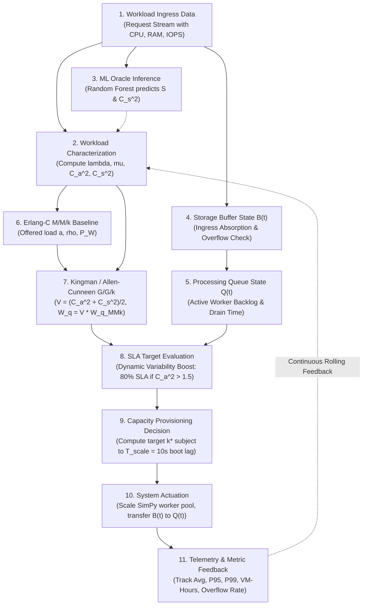
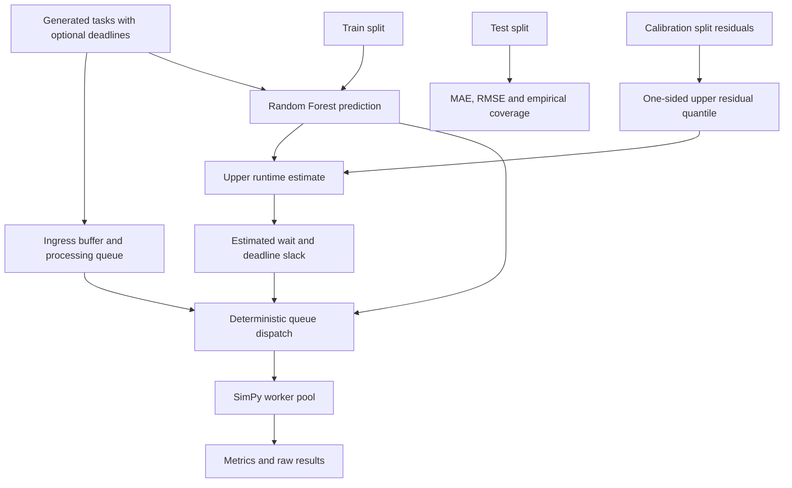

# System Architecture: Variability-Aware G/G/k Autoscaler

## 11-Step Pipeline Architecture

The end-to-end framework implements an 11-step feedback control loop connecting ingress cloud storage workloads to closed-form queueing approximations, machine learning inference, and dynamic capacity provisioning.

---

## Detailed Step Descriptions

1. **Workload Ingress Data**: Cloud requests arrive with resource features and inter-arrival intervals.
2. **Workload Characterization**: Calculates $\lambda = 1/\mathbb{E}[A]$, $\mu = 1/\mathbb{E}[S]$, $C_a^2 = \mathrm{Var}(A)/\mathbb{E}[A]^2$, and $C_s^2 = \mathrm{Var}(S)/\mathbb{E}[S]^2$.
3. **ML Oracle Inference**: A Random Forest regressor predicts runtime based on task metadata to supply estimated service variability $\hat{C_s^2}$.
4. **Storage Buffer State $B(t)$**: Absorbs incoming traffic burstiness; enforces capacity bounds and records rejection overflow events.
5. **Processing Queue State $Q(t)$**: Holds admitted tasks ready for server dispatch; computes backlog drainage delay $\frac{Q(t)}{k\mu}$.
6. **Erlang-C Baseline ($M/M/k$)**: Determines offered load $a = \lambda / \mu$, stability $\rho = a / k < 1$, and probability of delay $P_W$.
7. **Kingman / Allen-Cunneen ($G/G/k$)**: Scales Erlang-C delay by variability factor $V = (C_a^2 + C_s^2)/2$.
8. **SLA Target Evaluation**: Applies variability safety boost: $\alpha = 0.8$ when $C_a^2 > 1.5$ (bursty), $\alpha = 1.0$ when $C_a^2 \le 0.5$ (smooth).
9. **Capacity Provisioning Decision**: Calculates optimal $k^*$ balancing latency SLA vs VM-hour cost, factoring in $T_{\text{scale}} = 10\text{s}$ node spin-up lag.
10. **System Actuation**: Adjusts SimPy active worker instances and serves tasks from $Q(t)$.
11. **Telemetry & Metric Feedback**: Integrates real-time P95/P99 latency, VM-hours, and buffer overflow telemetry back to the controller.

## Research dispatch path

The new task-ordering experiment is separate from capacity autoscaling. Tasks may carry an optional relative deadline allowance, converted to an absolute deadline on arrival. A Random Forest is trained on one split, calibrated from held-out residuals on a second, measured on a validation split, and scored on a disjoint test split. Dispatch may use FIFO, actual runtime (oracle only), predicted runtime, absolute deadline, predicted slack, or slack computed from the calibrated upper runtime. The policy observes waiting tasks when a worker requests its next task; already-running work is not preempted.

Calibration and held-out test rows are disjoint. A single residual quantile gives the same additive margin to every task. Test coverage is reported empirically and does not imply a guarantee under distribution shift. See `simulation/research_benchmark.py` and the research section of the README for the exact metric definitions and benchmark factors.
